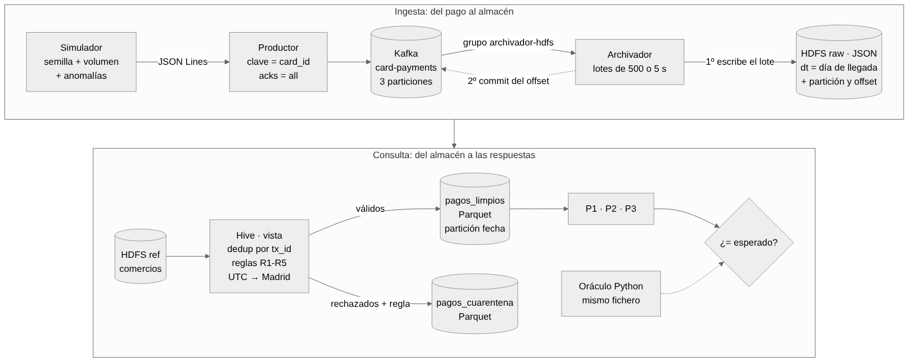

# Pagos con tarjeta · Proyecto individual de Sistemas de Big Data

Sistema de datos de un banco ficticio que **genera, transporta, almacena y consulta** los
pagos con tarjeta de sus clientes:

```
simulador → Kafka → archivador → HDFS → Hive → consultas de negocio
```

Todo se ejecuta en local con Docker, y cada resultado se **comprueba automáticamente**
contra unos resultados esperados calculados de forma independiente.



---

## 1. El caso

Cada vez que un cliente paga con su tarjeta, el banco recibe un evento: *la tarjeta X ha
pagado 20,76 € en el comercio Y, a las 13:36, en España, y se ha aprobado*. El sistema recoge
esos eventos en tiempo real, los guarda sin perder ninguno y permite responder con Hive tres
preguntas, una por cada equipo que usaría los resultados:

| # | Pregunta | Quién la usa |
|---|---|---|
| **P1** | ¿Cuánto se gasta cada día en cada categoría de comercio? (nº de pagos aprobados, importe total y ticket medio en €) | Negocio / marketing |
| **P2** | ¿A qué horas se paga más, y qué parte es online? (hora de Madrid) | Operaciones y producto digital |
| **P3** | ¿Qué tarjetas han pagado en dos o más países distintos el mismo día? | Equipo de fraude |

Los datos son simulados y reproducibles (misma semilla → mismos datos). Incluyen a propósito
**anomalías** (importes negativos, comercio inexistente, fechas futuras, campos vacíos,
valores no permitidos), **duplicados** y **tarjetas sospechosas**, para comprobar que el
sistema las trata bien. El detalle está en el [contrato de datos](docs/contrato_datos.md).

## 2. Cómo funciona

1. **Simulador** (`simulator/simulador.py`): genera los pagos en JSON Lines, con `--seed` y
   `--n-events`, y un *manifiesto* con todo lo que ha inyectado.
2. **Productor** (`producer/productor.py`): publica cada pago en el topic `card-payments`
   (3 particiones) con **`card_id` como clave**. Así todos los pagos de una tarjeta van a la
   misma partición y Kafka mantiene su orden, que es lo que necesita la detección de fraude.
3. **Archivador** (`consumer/archivador.py`): consumidor del grupo `archivador-hdfs`. Junta
   lotes (500 mensajes o 5 s), los escribe en HDFS y **solo después confirma el offset** en
   Kafka. Si muere entre medias, relee: puede repetir, pero nunca pierde (*at-least-once*).
   Cada fila guarda su partición, su offset y la hora de archivo, y cada fichero lleva su
   rango de offsets en el nombre:
   `/pagos/raw/card-payments/dt=2026-11-04/part-1-0000000000-0000000012.jsonl`.
4. **Hive**: la tabla `pagos_raw` lee esos JSON. La vista `v_pagos_validados` deduplica por
   `tx_id`, aplica las reglas R1-R5 y pasa de UTC a hora de Madrid. `02_limpiar.sql` vuelca
   los pagos válidos a **`pagos_limpios` (Parquet, particionada por día)** y los rechazados a
   `pagos_cuarentena`, con su motivo.
5. **Consultas** (`hive/consultas/`): P1, P2 y P3 sobre `pagos_limpios`.
6. **Comprobación**: `tests/calcular_esperado.py` calcula P1-P3 en Python puro con el mismo
   fichero de eventos, y `scripts/comparar_con_esperado.py` compara celda a celda.

Cuándo se guarda cada dato y cuándo se confirma el progreso en Kafka:
[docs/limitaciones.md](docs/limitaciones.md#cuándo-se-guarda-cada-dato-y-cuándo-se-confirma-el-progreso).
Todas las decisiones, con su porqué: [docs/decisiones.md](docs/decisiones.md).

### Qué se cuenta en cada paso (con la muestra de referencia)

| Paso | Qué se cuenta | Unidad | Muestra |
|---|---|---|---|
| Simulador | pagos distintos y mensajes enviados | eventos | 24 pagos, 27 mensajes (3 duplicados) |
| Kafka | mensajes por partición (offset final) | mensajes | 27 (p. ej. 10 + 13 + 4) |
| HDFS raw / `pagos_raw` | filas archivadas, relecturas incluidas | filas = mensajes | 27 |
| `v_pagos_validados` | pagos distintos por `tx_id` | pagos | 24 |
| `pagos_limpios` / `pagos_cuarentena` | pagos válidos / rechazados por regla | pagos | 19 / 5 (uno por regla) |
| P1 | pagos aprobados, importe total y ticket medio | nº y € (`DECIMAL(10,2)`) | 26/10 ALIMENTACION: 2 pagos, 35,95 €, 17,98 € |
| P2 | intentos válidos por hora de Madrid y % online | nº y % (1 decimal) | 20 h: 2 pagos, 100,0 % online |
| P3 | países distintos por tarjeta y día de Madrid | nº de países y de pagos | CARD-000002, 27/10: 2 países (ES, GB), 5 pagos |

Los importes son siempre `DECIMAL`, nunca `float`; los instantes se guardan en **UTC** y se
convierten a hora de Madrid solo para el día y la hora de negocio.

## 3. Arrancar y comprobar el sistema

**Requisitos:** Docker Desktop con al menos **6 GB** de memoria (Settings → Resources) y una
terminal con `bash` (macOS, Linux o Git Bash en Windows). Si tienes el laboratorio de clase
arrancado, páralo antes: usa los mismos puertos.

### 3.1 Primera vez (≈ 10 min, sobre todo descargas)

```bash
git clone https://github.com/mmartinezvaras/bigdata-pagos-tarjeta.git
cd bigdata-pagos-tarjeta
chmod +x pagos
./pagos up                    # construye las imágenes y arranca los servicios
./pagos ready                 # espera a HDFS, Kafka y Hive
./pagos init                  # topic card-payments (3 particiones) y carpetas en HDFS
./pagos check                 # prueba de humo: Python ↔ HDFS ↔ Kafka
./pagos subir-ref             # catálogo de comercios → /pagos/ref/comercios
./pagos hivef 01_tablas.sql   # base de datos pagos, tablas y vista
```

`./pagos check` debe terminar con `Entorno listo: Python ↔ HDFS ↔ Kafka funcionan.` y
`01_tablas.sql` con la lista de las 5 tablas.

### 3.2 Recorrido completo con la muestra de referencia (≈ 4 min)

```bash
./pagos reset-todo            # sistema vacío
./pagos demo                  # recorrido guiado, con pausas (Enter para avanzar)
```

La demo publica la muestra de 27 pagos, la archiva, **para el archivador** mientras llegan
27 mensajes más (la muestra reenviada: todo duplicados), lo recupera y termina en Hive con:

```
HIVE DA EXACTAMENTE LO ESPERADO
RESULTADO DE LA DEMO: OK
```

El mismo recorrido, paso a paso:

```bash
./pagos reset-todo
./pagos py producer/productor.py tests/muestra/eventos.jsonl
./pagos archivador start && sleep 15 && ./pagos lag    # LAG = 0 en las 3 particiones
./pagos verificar                                      # no falta nada de Kafka en HDFS
./pagos hivef 02_limpiar.sql
./pagos consultas                                      # P1, P2, P3 → evidencias/hive/
./pagos py scripts/comparar_con_esperado.py            # contra tests/muestra/esperado
```

### 3.3 Pruebas

Cada una parte de cero, explica sus pasos y guarda su registro en `evidencias/pruebas/`:

```bash
./pagos prueba relectura      # el archivador muere tras escribir y antes del commit (≈ 3 min)
./pagos prueba caida          # se mata el archivador mientras llegan pagos (≈ 4 min)
./pagos prueba volumen        # 100.000 pagos (≈ 5 min) · o: ./pagos prueba volumen 20000
```

| Prueba | Resultado |
|---|---|
| Muestra de referencia (27 mensajes) | Hive = resultados calculados a mano |
| Dato incorrecto | Cada anomalía, en cuarentena con su regla (1 por regla en la muestra) |
| Relectura (muere antes del commit) | 0 perdidos, 1 fila releída, eliminada al deduplicar |
| Caída (SIGKILL con tráfico) | LAG 169 → 1.727 con el archivador muerto → 0 en 6 s al volver, 0 perdidos |
| Volumen (102.000 mensajes) | Kafka → HDFS en 139 s, Hive en 39 s, 0 perdidos, resultados = esperados |

Detalle y lectura de las cifras: [docs/pruebas.md](docs/pruebas.md).

### 3.4 Parar

```bash
./pagos stop                  # para todo CONSERVANDO los datos
```

No uses `docker compose down -v`: borra los volúmenes (HDFS, Kafka y el catálogo de Hive).

## 4. Referencia de comandos

| Comando | Qué hace |
|---|---|
| `./pagos up` · `ready` · `stop` | arrancar, esperar a que esté listo, parar |
| `./pagos init` · `check` · `subir-ref` | preparar topic y HDFS, prueba de humo, subir catálogo |
| `./pagos py <script.py> ...` | ejecutar Python en el contenedor `app` |
| `./pagos archivador start \| stop \| kill \| logs` | controlar el archivador (`kill` = muerte en seco) |
| `./pagos lag` | offsets confirmados, final del log y LAG por partición |
| `./pagos raw` · `verificar` | ficheros en raw · ¿está en HDFS todo lo de Kafka? |
| `./pagos hivef <fichero.sql>` · `hive "SQL;"` | ejecutar SQL en Hive |
| `./pagos consultas [carpeta]` | P1, P2, P3, control y cuarentena → TSV |
| `./pagos reset-topic` · `reset-todo` | vaciar el topic · vaciar todo para repetir una prueba |
| `./pagos demo` · `prueba <nombre>` | demo de la defensa · pruebas de la fase 6 |
| `./pagos kafka <script> ...` · `hdfs ...` | herramientas de Kafka y HDFS directamente |

Simulador: `./pagos py simulator/simulador.py --help` (`--seed`, `--n-events`, `--n-cards`,
`--start`, `--days`, `--anomaly-rate`, `--dup-rate`, `--n-suspicious`, `--out`, `--manifest`).

Interfaces web: NameNode en http://localhost:9870 · HiveServer2 en http://localhost:10002.
Hive también se puede consultar desde DBeaver (Apache Hive, controlador Hive 4+,
`localhost:10000`, base `default`, usuario `root`, sin contraseña).

### Servicios y tablas

| Servicio | Imagen | Para qué |
|---|---|---|
| `namenode`, `dn1`, `dn2` | Hadoop 3.4.2 (imagen del laboratorio) | HDFS, replicación 2 |
| `kafka` | `apache/kafka:3.9.1` (KRaft, 1 broker) | transporte de los eventos |
| `hiveserver2` | `apache/hive:4.1.0` (configuración de la clase 08) | tablas y consultas SQL |
| `app` | Python 3.12 + `confluent-kafka` + `hdfs` | simulador, productor, pruebas |
| `archivador` | la misma imagen que `app` | consumidor Kafka → HDFS (se arranca aparte) |

| Tabla | Formato | Contenido |
|---|---|---|
| `pagos.pagos_raw` | JSON, partición `dt` (día de archivo) | todo lo que llegó, tal cual |
| `pagos.comercios` | CSV | catálogo de comercios |
| `pagos.v_pagos_validados` | vista | deduplicación + reglas + hora de Madrid |
| `pagos.pagos_limpios` | Parquet + Snappy, partición `fecha` (día de Madrid) | pagos válidos |
| `pagos.pagos_cuarentena` | Parquet + Snappy | pagos rechazados con su `regla` |

## 5. Estructura del repositorio

```
pagos            atajos para manejar el sistema (./pagos sin argumentos muestra la ayuda)
compose.yaml     todos los servicios
docker/          imágenes y configuración de Hadoop, Hive y Python
simulator/       simulador y catálogo de comercios
producer/        productor Kafka
consumer/        archivador Kafka → HDFS
hive/            DDL, limpieza, reset y consultas (hive/consultas/)
tests/           oráculo, tests del simulador y muestra de referencia (tests/muestra/)
scripts/         prueba de humo, verificación, comparación, pruebas y demo
evidencias/      salidas guardadas: Kafka, HDFS, Hive y registros de las pruebas
docs/            contrato, decisiones, pruebas, limitaciones, defensa y diagrama
```

## 6. Documentación

- [Contrato de datos](docs/contrato_datos.md): campos, tipos, unidades, reglas y anomalías.
- [Muestra de referencia](tests/muestra/README.md): los 27 mensajes y sus resultados esperados, comprobables a mano.
- [Decisiones](docs/decisiones.md): qué se decidió, por qué y qué se descartó (D1-D25).
- [Pruebas](docs/pruebas.md): qué demuestra cada prueba, resultados y lectura de las cifras.
- [Garantías y limitaciones](docs/limitaciones.md): cuándo se guarda y se confirma cada dato, y qué no cubre el sistema.
- [Guía de defensa](docs/defensa.md): guion, demo, preguntas y cambios en directo.
- [Presentación de la defensa](docs/presentacion.pdf) (8 diapositivas: caso, arquitectura, datos, decisiones, pruebas, demo y límites).
- [Diagrama](docs/arquitectura.mmd) (fuente Mermaid) · [imagen](docs/arquitectura.png).

## 7. Fuentes y material reutilizado

- **Imagen y configuración de Hadoop/HDFS** (`docker/hadoop/`): laboratorio de la asignatura
  (`LABORATORIO_ALUMNOS_HDFS`), con 2 DataNodes en lugar de 3.
- **Imagen y configuración de Hive** (`docker/hive/hive-site.xml`, servicio `hiveserver2`):
  material de la clase 08, cambiando las rutas del warehouse a `/pagos`.
- **Patrón de tablas externas, particiones y Parquet** en Hive: práctica de la clase 09.
- Imágenes públicas `apache/kafka:3.9.1`, `apache/hive:4.1.0`, `eclipse-temurin:11-jre-jammy`
  y `python:3.12-slim`. Librerías Python `confluent-kafka` y `hdfs`.

## 8. Versión entregada

La versión entregada está marcada en git con la etiqueta **`v1.0`**. Cualquier cambio
posterior a la entrega se anotará aquí, con su motivo.
